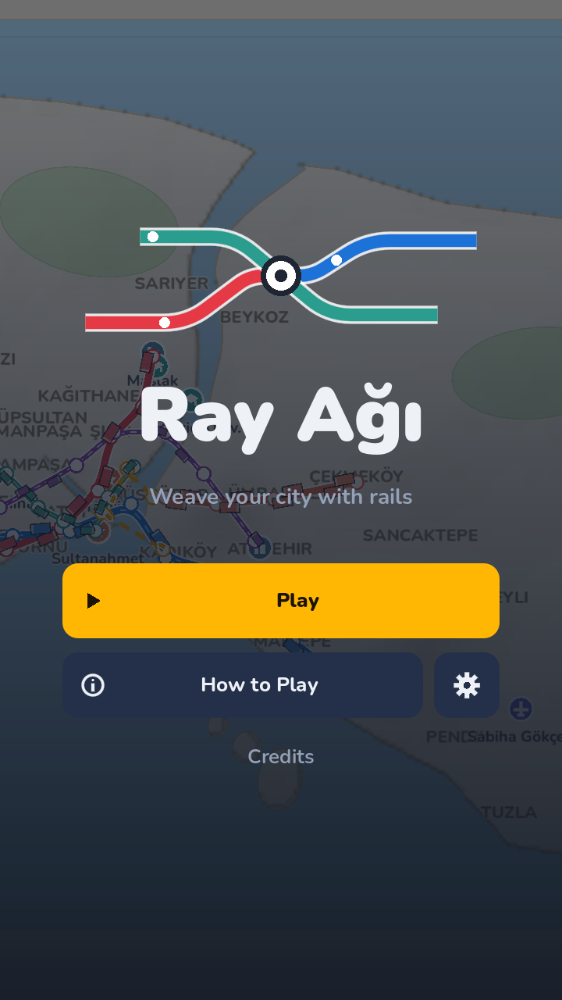
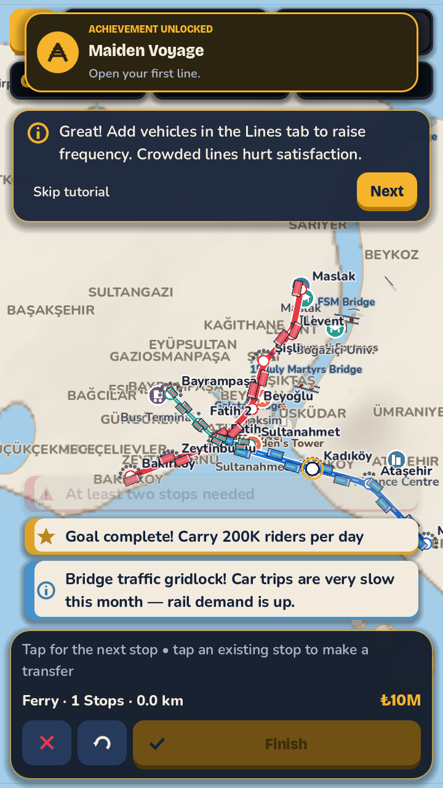
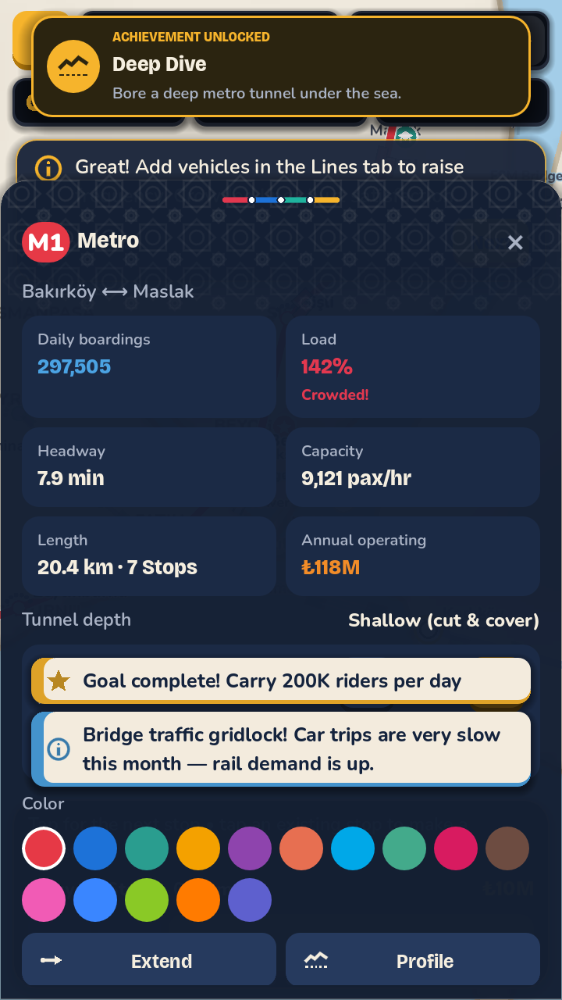
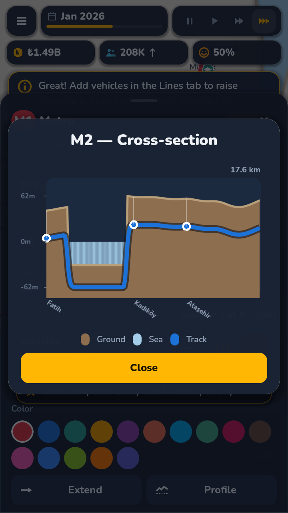
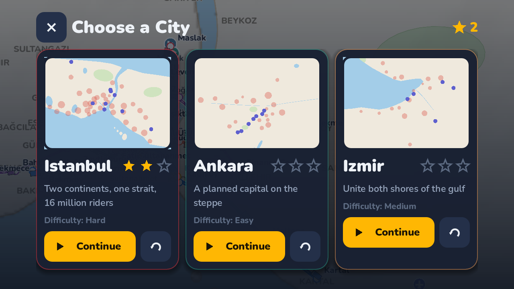
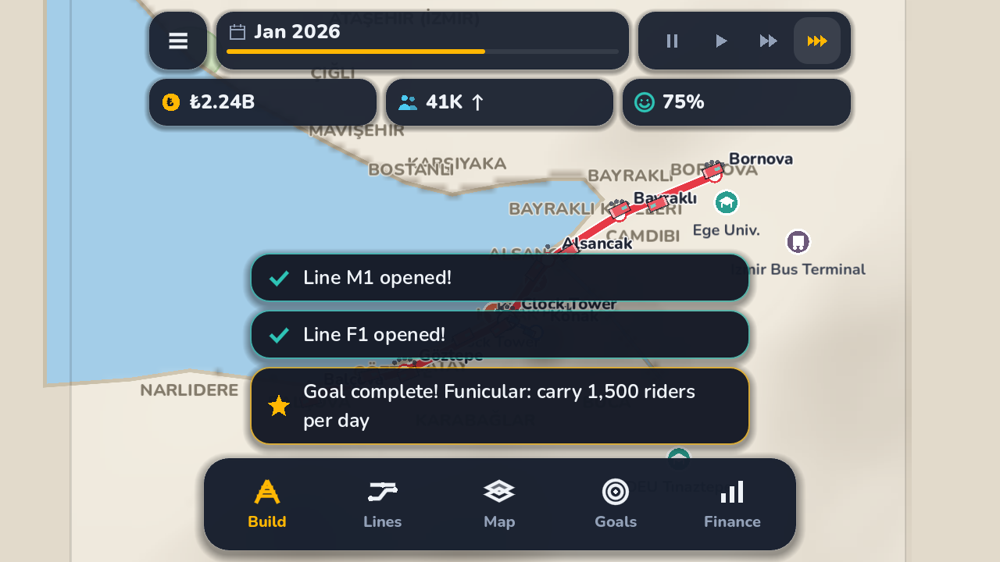
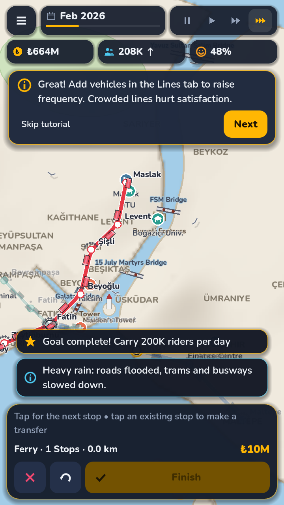
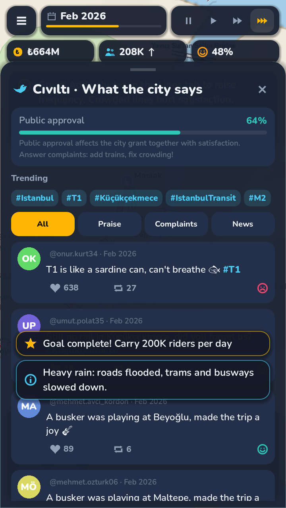
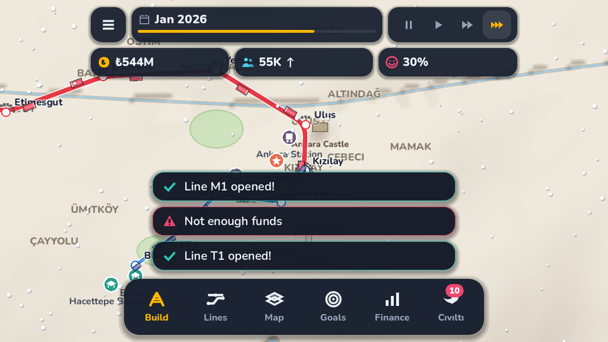

# Ray Ağı — Metro Kur (iOS & Android)

İstanbul, Ankara ve İzmir'in gerçek coğrafyası üzerinde kendi raylı sistem ağını kurduğun,
mobil için baştan tasarlanmış bir ulaşım-strateji oyunu. **Godot 4.3** ile geliştirildi.

> Çalışma adı "Ray Ağı"dır; `project.godot` içindeki `config/name` ve dışa aktarma
> ayarlarındaki paket adı (`com.rayagi.metro`) yayından önce kendi markanla değiştirilmelidir.

## Neden Godot (Unity değil)?

| Kriter | Godot 4.3 | Unity |
|---|---|---|
| Lisans / gelir payı | MIT, ücretsiz, gelir payı yok | Ücretli planlar, lisans politikası değişkenliği |
| 2D vektör çizim performansı | Yerleşik `CanvasItem` çizimi, çok hafif | Ek paket/sprite tabanlı |
| APK/IPA boyutu | ~25–35 MB | ~45–70 MB |
| Metin tabanlı proje (CI, inceleme) | Tamamen metin (`.gd`, `.tscn`) | Büyük ikili/YAML sahneleri |
| iOS + Android dışa aktarma | Yerleşik | Yerleşik |

Oyun tamamen 2D, harita ve hatlar vektörel çiziliyor; bu tür bir oyun için Godot hem daha hafif
hem de daha hızlı geliştirilebilir. Tüm UI kodla üretildiği için farklı ekran oranlarına
(telefon dikey/yatay, tablet) otomatik uyum sağlar.

## Oyun özellikleri

- **3 şehir**: İstanbul (zor), Ankara (kolay), İzmir (orta — 2 yıldızla açılır). Basitleştirilmiş
  gerçek kıyı çizgileri, Boğaz, Haliç, Adalar, körfez, göller, tepeler ve korunan ormanlar.
- **6 sistem**: Metro (sığ/derin tünel), Tramvay, Metrobüs, Banliyö, Füniküler, Vapur —
  her birinin hız, kapasite, maliyet, eğim ve su geçiş kuralları farklı.
- **Tünel derinliği**: sığ (aç-kapa) ucuz ama suyun altından geçemez; derin TBM tüneli Boğaz'ın
  altından geçer. Her hat için **boy kesit** (yükseklik profili) görünümü.
- **Gerçekçi talep modeli**: semt nüfusu ve çekim merkezleri (iş, üniversite, havalimanı, otogar)
  arasında gravite modeli; yolcu, raylı sistemi araba süresiyle karşılaştırarak seçer;
  aktarmalar, yürüme mesafesi, bekleme süresi ve kapasite kısıtı hesaplanır.
- **Araç ve sefer sıklığı yönetimi**, **depo kapasitesi**, hat rengi, uzatma, ring hat, hat kaldırma.
- **Ekonomi**: bilet geliri + memnuniyete bağlı belediye desteği − işletme gideri; kredi limiti;
  6 ay limit aşımında iflas. **Yıl sonu raporu**, finans grafikleri.
- **Şehir hedefleri** ve 3 yıldız sistemi, şehir kilitleri.
- **Harita katmanları**: Nüfus, Çekim, Yükseklik ısı haritaları.
- **Eğitim (tutorial)**, Nasıl Oynanır, Türkçe/İngilizce dil desteği.
- **Mobil UX**: tek parmakla kaydırma (ataletli), iki parmakla yakınlaştırma, çift dokunuşla zoom,
  uzun basış, titreşim geri bildirimi, çentik (safe area) desteği, Android geri tuşu,
  dikey + yatay + tablet düzenleri (yatayda paneller sağa yaslanır).
- **Otomatik kayıt** (30 sn'de bir, uygulama arka plana alınınca ve çıkışta).
- Ağır yolcu hesabı **arka plan thread'inde** çalışır → ağ büyüse de 60 FPS.
- Özgün müzik ve ses efektleri (`tools/gen_audio.py` ile üretildi), özgün ikon/splash.

### Şehre özel detaylar ve mekanikler
- **İstanbul**: Boğaz ve Marmara üzerinde uçan martı sürüleri ve martı sesleri, dalga ambiyansı,
  vapur düdüğü, 15 Temmuz / FSM / Yavuz Sultan Selim / Galata köprüleri, Galata Kulesi, Kız Kulesi,
  Rumeli Hisarı. **Tarihi yarımada arkeolojisi**: Fatih/Sultanahmet çevresinde yer altı kazısı
  yaparsan tarihi buluntu çıkabilir (ek maliyet + haber). Rastgele **köprü trafiği**, derbi, sağanak
  olayları talebi değiştirir. Vapur yolculuğu daha konforlu (çay-simit).
- **Ankara**: Kışın (Ara–Şub) kar yağar, ekranda kar efekti ve bozkır rüzgârı; tramvay ve metrobüs
  yavaşlar, **kar fırtınası** olayında iyice yavaşlar — metro altın değerinde. **Üniversite dönemi**:
  ODTÜ/Bilkent/Hacettepe talebi Eyl–Eki'de artar, yazın düşer. Atakule, Ankara Kalesi.
- **İzmir**: Kuş Cenneti'nde yürüyen **flamingolar**, martılar, dalga sesi; **yaz sezonu** vapur ve
  sahil talebini artırır, **imbat** rüzgârı vapuru daha cazip yapar, **Eylül'de Enternasyonal Fuar**
  Kültürpark'a talebi 3 katına çıkarır. Tarihi Asansör, Kadifekale.

### Sosyal medya: "Cıvıltı"
Şehir halkı kararlarına sosyal ağda tepki verir: yeni hat açılışında sevinç gönderileri, havalimanı/
kampüs bağlantılarına teşekkürler, kalabalık ve seyrek seferlere şikayetler (@rayagi_resmi etiketli),
hat kapatınca öfke, yıl sonu haberleri, şehir olayları ve yerel tatlar (simit-martı, boyoz, ayaz…).
- **Kamuoyu desteği** gönderilerin duygu ve beğeni sayısından hesaplanır; memnuniyetle birlikte
  belediye desteğini etkiler. Şikayet edilen hatta araç eklersen resmi hesap duyurur, halk teşekkür eder.
- Gündem (trend hashtag'ler), filtreler (Övgü/Şikayet/Haber), beğeni, viral gönderi bildirimi, okunmamış rozeti.
- Türkçe eklerde ünlü uyumu otomatik (M1'de, Fatih'ten, Bostancı'ya…).

## Proje yapısı

```
project.godot            Motor ayarları (GL Compatibility renderer, mobil)
export_presets.cfg       Android APK, Android AAB (Play Store), iOS ön ayarları
scenes/main.tscn         Giriş sahnesi
scripts/
  autoload/              I18n (TR/EN), Settings, Audio, SaveManager
  data/                  city_data.gd (şehir coğrafyası, semtler, hedefler), transit_modes.gd
  core/                  city_map, network (doğrulama+maliyet), demand_model, game_state
  game/                  Harita/etiket/hat/araç/taslak katmanları, dokunmatik kamera
  ui/                    Tema, ikonlar, sheet/modal/toast, grafikler, boy kesit
  screens/               main_menu, game_screen, game_panels
assets/                  Yazı tipi (Nunito, OFL), sesler, ikonlar, önceden pişirilmiş harita rasterleri
tools/                   gen_audio.py, gen_icons.py, process_ambience.py, bake_maps.(gd|tscn), check_i18n.py
tests/                   test_core (simülasyon/denge), shots (görsel duman testi)
.github/workflows/       CI: testler + Android APK + iOS Xcode projesi
```

## Geliştirme

1. [Godot 4.3](https://godotengine.org/download/archive/4.3-stable/) indir, projeyi aç (`project.godot`).
2. F5 ile çalıştır. Masaüstünde fare tekerleği = zoom, sürükle = kaydır.
3. Testler:
   ```bash
   godot --headless --path . --import
   godot --headless --path . tests/test_core.tscn          # simülasyon + denge + performans
   python3 tools/check_i18n.py                              # eksik çeviri anahtarı kontrolü
   xvfb-run godot --path . --rendering-driver opengl3 --resolution 720x1280 tests/shots.tscn -- --out=/tmp/shots
   ```
4. Şehir verisini değiştirirsen harita rasterlerini yeniden pişir:
   `godot --headless --path . tools/bake_maps.tscn`

### Dengeyi ayarlamak
- Maliyetler, hız, kapasite: `scripts/data/transit_modes.gd`
- Başlangıç parası, belediye desteği, talep çarpanı, hedefler: `scripts/data/city_data.gd`
- Talep modeli katsayıları: `scripts/core/demand_model.gd` (`DEMAND_SCALE`, `MAX_SHARE`, araç hızları)
- Bilet fiyatı, ay süresi: `scripts/core/game_state.gd` (`FARE`, `MONTH_SECONDS`)

## Android yayını

1. Godot → *Editor → Manage Export Templates* → 4.3 şablonlarını indir.
2. *Editor Settings → Export → Android*: Android SDK ve Java (JDK 17) yollarını gir.
3. Yayın anahtarı oluştur:
   ```bash
   keytool -genkey -v -keystore release.keystore -alias rayagi -keyalg RSA -keysize 2048 -validity 10000
   ```
   *Project → Export → Android Play Store (AAB) → Keystore/Release* alanlarına gir
   (anahtarı **repoya koyma**; `.gitignore` zaten hariç tutuyor).
4. AAB için *Project → Install Android Build Template* çalıştır, sonra
   *Export Project → Android Play Store (AAB)* → `build/android/RayAgi.aab`.
5. Google Play Console: uygulama oluştur → **Ücretli** fiyat → AAB'yi yükle → mağaza girişi
   (`docs/STORE_LISTING.md`) → içerik derecelendirmesi (şiddet yok, 3+) → gizlilik politikası
   (`docs/PRIVACY.md`, veri toplanmıyor).

## iOS yayını

1. macOS + Xcode 15+ gerekir. Apple Developer hesabı (yıllık).
2. *Project → Export → iOS*: `App Store Team ID` ve `Bundle Identifier` (com.rayagi.metro) gir.
3. *Export Project* → `.ipa` veya "Export Project Only" ile Xcode projesi al;
   Xcode'da *Product → Archive → Distribute App → App Store Connect*.
4. App Store Connect: fiyat katmanı seç (ücretli), ekran görüntüleri (6.7", 6.5", 5.5", iPad 12.9"),
   açıklama (`docs/STORE_LISTING.md`), gizlilik: "Veri toplanmıyor".

## CI (GitHub Actions)

`.github/workflows/build.yml` her push'ta:
- simülasyon testlerini ve çeviri kontrolünü çalıştırır,
- Android APK üretir (gizli anahtarlar tanımlıysa imzalı release, değilse debug),
- macOS'ta iOS Xcode projesini dışa aktarır.

İmzalı Android için repo *Secrets*: `ANDROID_KEYSTORE_BASE64`, `ANDROID_KEY_ALIAS`, `ANDROID_KEY_PASSWORD`.

## Lisanslar
- Kod: proje sahibine aittir.
- Godot Engine: MIT. Nunito yazı tipi: SIL OFL 1.1 (`assets/fonts/OFL.txt`).
- Müzik, ses efektleri, ikonlar: bu proje için üretilmiş özgün içerik.
- Ortam sesleri (martı, dalga, trafik): OpenGameArt, **CC0** — ayrıntı `assets/audio/amb/CREDITS.md`.
- Noto Emoji yazı tipi: SIL OFL 1.1 (`assets/fonts/NotoEmoji-OFL.txt`).

## Ekran görüntüleri

| | | |
|---|---|---|
|  |  |  |
|  |  |  |
|  |  |  |
